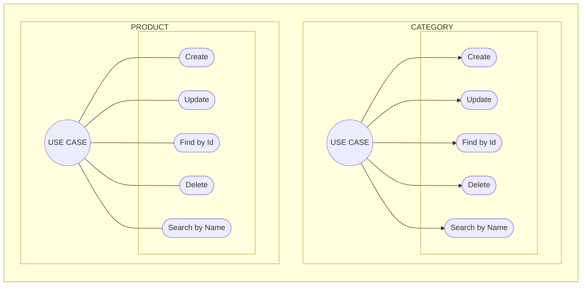
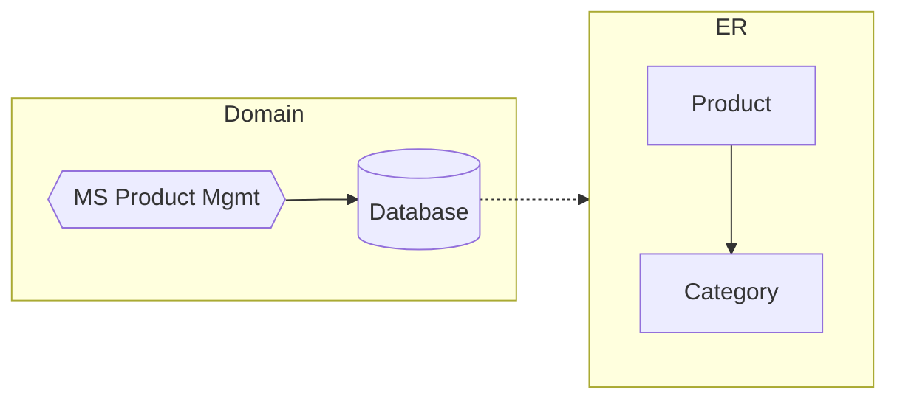
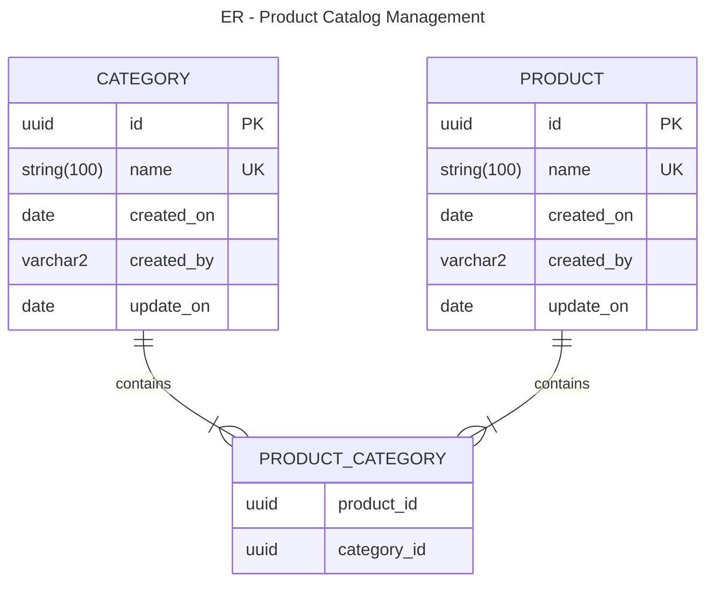
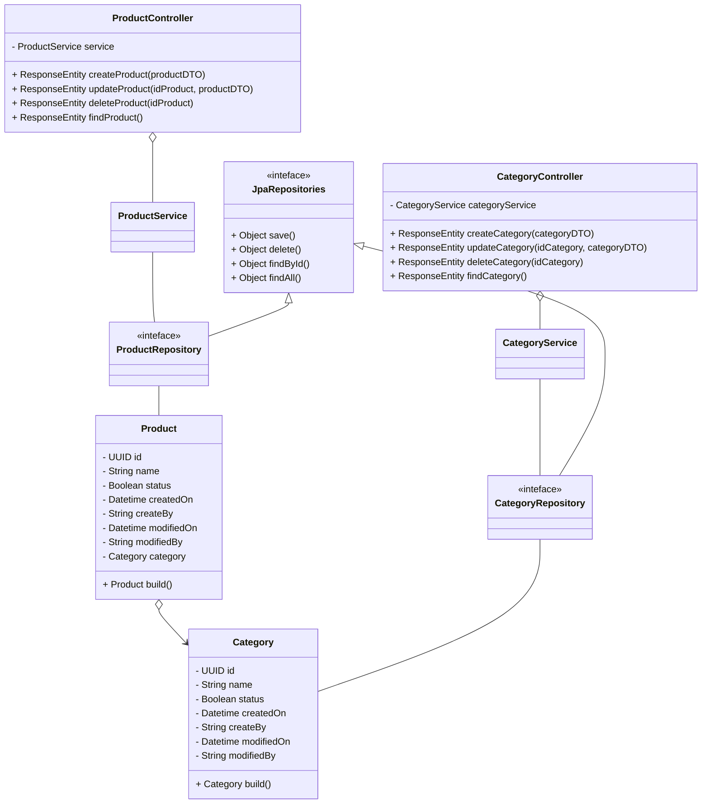

# Product Catalog Management
##### _v 1.0.0_
<i style="font-size:14px">  </i>


### **1. Description**

This is an application responsible for maintaining a product database. 

- #### Tecnologies and Frameworks
    | | JDK 17|
    |---|---|
    | | `v 3.0.6` |
    |  | latest      |
    |  | latest      |
    |              | latest      |
    |              | latest      |
    | ModelMapper        | 3.0.0       |
    |  | 2.1.0       |


### **2. Use Case**
- Maintain the product registration in its own database, and allow registration operations, consultation, change of records.


#### 2.1 Compoments


#### 2.2 Entity Relationship


[Mermaid](https://mermaid.live/edit#pako:eNrNUsFqwzAM_RXhc33Z0beRlh3GaMjaw4YhaLaXmiZycO1BSPLvc5q2W8sGO042yNLTk2VLPVNOGyYY51xSsKE2AlYFcMi901EFyDBg7Sp4QsLKNIaCpGOw8UuLlcdGEiTJ7jerh3XxAsPA-dBDXqyX22xTXvwClKOAlg4z4RQAfyJM6-qWfrYnidFqSDt__PJ9oFc79HdA2BjYfkM0BgPKm6R06egHyhl8625YsZ3UhTRev-PfVVT--lnt3NvS6htApWyV890FSRnZgjXGN2h1GpNjJsnCLk2CZCIdNfq9ZJLGFIcxuOeOFBPBR7Ngc3mnMWHiHetD8rZIr86d7fETT8jFAg)


### **3. Class Diagram**
- Below is an example model of the organization of microservice classes. 





## 4. How to Run

### Development Environment

```sh
./mvnw spring-boot:run
```

The service will be available at: [http://localhost:8080/product-order](http://localhost:8080/product-order)

### Product Environment (Docker)

```sh
docker-compose up --build
```

The service will be available at: [http://localhost:9090/product-order](http://localhost:9090/product-order)

## 5. Main Endpoints

- `POST   /`           - Create product
- `GET    /{id}`       - Find product by ID
- `PUT    /{id}`       - Update product
- `PATCH  /{id}`       - Change product status
- `DELETE /{id}`       - Delete product
- `GET    /`           - List all products

## 6. Tests

To run automated tests:

```sh
./mvnw test
```

## 7. OpenAPI Documentation

Acess the documentation at:  
[http://localhost:8080/product-order/swagger-ui.html](http://localhost:8080/product-order/swagger-ui.html)  
or
[http://localhost:9090/product-order/swagger-ui.html](http://localhost:9090/product-order/swagger-ui.html) (produção)

---

> Projetc developed by Leandro Barbosa.
    
```

